# VyapaarCart

> A full-stack local marketplace for pre-owned goods, built to demonstrate an end-to-end buyer–seller workflow: authenticated listing management, conversations, favourites, test payments, and a delivery lifecycle.

[Live demo](https://vyapaarcart.vercel.app) · [Source code](https://github.com/mhrj7/VyapaarCart)

## Why this project

VyapaarCart models the core workflow of a local marketplace such as OLX: a seller posts a listing, a buyer discovers it, contacts the seller, requests an order, completes a test payment after acceptance, and follows a delivery status timeline. It is deliberately implemented as a modular Next.js application backed by a relational database rather than as a static UI demo.

## Current capabilities

| Area | Implemented behaviour |
| --- | --- |
| Identity | Clerk sign-in with the existing email/social configuration; protected write operations on the server |
| Listings | Create, edit, archive, and delete seller-owned listings; search, category/city/price filters, and sorting |
| Images | Validated JPG, PNG, and WebP uploads up to 5 MB; new listing media is stored through an S3-compatible object-storage adapter and deleted with its listing |
| Product media | Multiple images per product, persisted display order and metadata, seller upload/reorder/removal controls, and a public thumbnail gallery. Failed file deletion retains cleanup metadata for retry. [Implementation and verification](docs/product-media.md) |
| Seller catalog | Approved sellers and assigned staff can manage public stores, categorized products, searchable attributes, and variants with unique SKUs and prices |
| Product search | Public `/products` catalog with indexed title/description relevance, category and seller filters, SQL attribute filtering and bounded pagination. [Design and tests](docs/product-search.md) |
| Warehouses | Seller-only warehouse management, separate per-SKU/location stock, version-checked updates, and atomic 10-minute checkout reservations. [Design and tests](docs/warehouses.md) |
| Inventory audit | Authorized stock edits record actor, reason, previous/new quantities and version atomically with stock. Latest 100 changes are visible per warehouse. [Contract and failure tests](docs/warehouses.md#stock-audit-contract-m-21) |
| Marketplace | Favourites, buyer–seller conversations, seller dashboard, and shareable listing pages with metadata |
| Orders | Buyer order requests, seller decision flow, order history, and persisted payment/shipping data |
| Payments | Razorpay test-order creation and server-side HMAC signature verification |
| Delivery | Seller pickup profile, local deterministic shipment simulator by default, plus a Shiprocket sandbox/production carrier adapter with persisted tracking events and handover state |
| Notifications | Intended-user in-app updates for order and shipment events; a Resend-compatible email delivery adapter is configurable through server-only variables |
| Platform | Neon Postgres schema with foreign keys and indexes; deployed on Vercel |

## Architecture

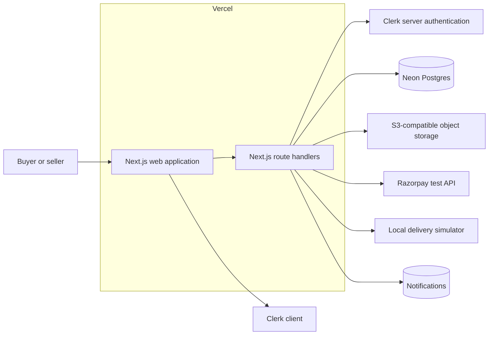

The application is a **modular monolith**: page modules and typed route handlers share a single database schema. This keeps the project straightforward to run and reason about while leaving natural boundaries for future extraction, such as payment, notifications, and event delivery.

## Core buyer–seller flow

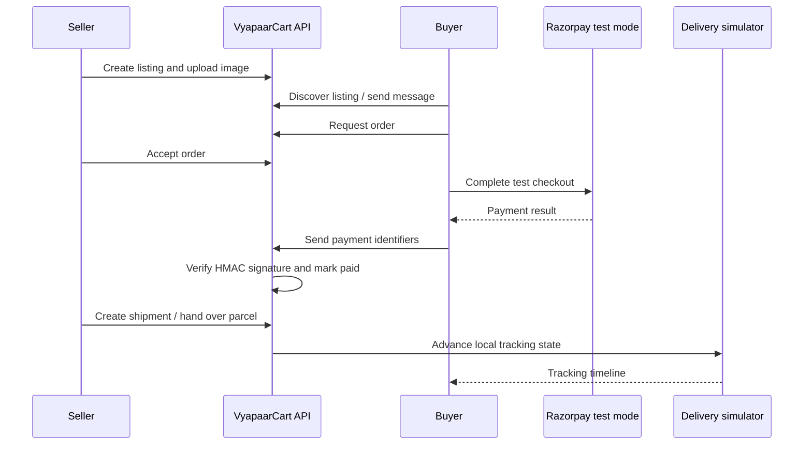

## Data model

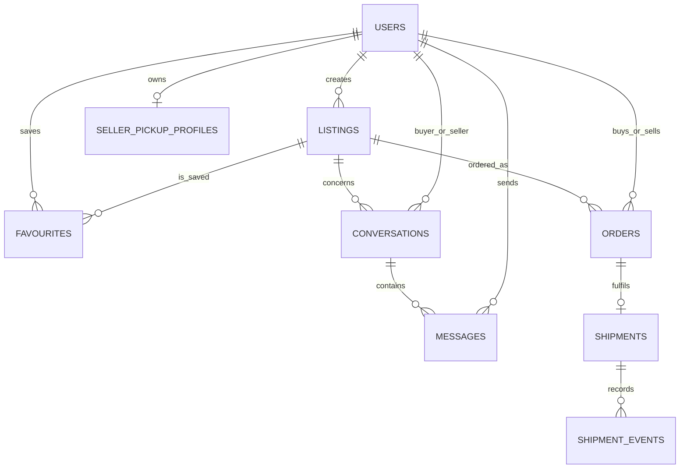

The database schema includes ownership relationships, cascading deletes, uniqueness constraints for duplicate buyer/listing orders and shipment identifiers, and query indexes for active listings, conversations, orders, shipments, and tracking events.

## Technology choices

| Layer | Choice | Reason |
| --- | --- | --- |
| Web + API | Next.js 16, React 19, TypeScript | One typed application for UI and server-side route handlers |
| Authentication | Clerk | Managed sign-in and secure server-side identity checks |
| Database | Neon Postgres + Drizzle ORM | Relational integrity with type-safe SQL access and migrations |
| Object storage | S3-compatible API | Provider-independent listing-image storage; works with Cloudflare R2, AWS S3, MinIO, or another compatible provider |
| Test payment | Razorpay | Realistic order creation and signature verification without live charges |
| Hosting | Vercel | Server-rendered Next.js deployment with managed environment variables |

## Local setup

### Prerequisites

- Node.js 22 or newer
- A Neon Postgres database
- An S3-compatible bucket with public read access or a public delivery domain
- A Clerk application
- Razorpay test keys if testing checkout

### Run it

```bash
git clone https://github.com/mhrj7/VyapaarCart.git
cd VyapaarCart
cp .env.example .env.local
npm install
npm run db:push
npm run dev
```

Open `http://localhost:3000`.

### Docker Compose

With Docker Desktop running, copy `.env.example` to `.env.local` and populate the Clerk development keys plus any integrations you want to exercise locally. `DATABASE_URL` is overridden inside Compose, so it always points at the local PostgreSQL service. Then start the local application and PostgreSQL database with:

```bash
docker compose up --build
```

The application is available at `http://localhost:3000`; the database schema is applied automatically to the local Postgres container. Stop the environment with `docker compose down`. Add `-v` only when you intentionally want to remove local database data.

### Environment variables

| Variable | Required for | Notes |
| --- | --- | --- |
| `DATABASE_URL` | Persistent marketplace data | Neon Postgres connection string |
| `S3_ENDPOINT` | Listing-image storage | S3-compatible API endpoint, such as a Cloudflare R2, AWS S3, or MinIO endpoint |
| `S3_REGION` | Listing-image storage | Region; use the provider's documented value (`auto` for Cloudflare R2) |
| `S3_ACCESS_KEY_ID` | Listing-image storage | Server-only access key |
| `S3_SECRET_ACCESS_KEY` | Listing-image storage | Server-only secret key |
| `S3_BUCKET` | Listing-image storage | Bucket name |
| `S3_PUBLIC_BASE_URL` | Public listing images | Public bucket or CDN base URL, without a trailing slash |
| `NEXT_PUBLIC_CLERK_PUBLISHABLE_KEY` | Sign-in UI | Browser-safe Clerk key |
| `CLERK_SECRET_KEY` | Protected API routes | Server-only Clerk key |
| `RAZORPAY_TEST_KEY_ID` | Test checkout | Never use a live key in this project |
| `RAZORPAY_TEST_KEY_SECRET` | Test payment verification | Server-only secret |
| `NOTIFICATION_EMAIL_PROVIDER` | Email delivery selection | Set to `resend` only when the two variables below are configured |
| `RESEND_API_KEY` | Resend email API | Server-only API key |
| `NOTIFICATION_FROM_EMAIL` | Resend sender identity | A verified sender address or domain |

Never commit real credentials. Vercel environment variables are used for the deployed application.

## Verification performed

- `npm run build` completes successfully with TypeScript checks.
- `npm run lint` completes with no errors; the only remaining notices are four Next.js image-optimization warnings for user-uploaded image elements.
- Production home page and the public listings endpoint return `200` from the Vercel deployment.
- Database schema was applied to the connected Neon database.

No performance or load-test figures are claimed because they have not yet been measured.

## Intentional current limitations

This repository **does not yet claim** to be the complete multi-vendor commerce platform described in the original roadmap. In particular, it does not yet include:

- Live-money checkout, settlement, or courier booking; payment and refund verification remains in provider test mode
- Redis rate limiting, Kafka/Redpanda, or OpenTelemetry/Prometheus/Grafana
- Webhook endpoints, HMAC-signed webhook deliveries, retry queues, delivery console, secret rotation, replay, or endpoint-level rate limits
- FastAPI, Alembic, pytest, Playwright, k6, or GitHub Actions CI
- A live courier booking; a Shiprocket adapter is implemented and the local simulator remains the safe default

## Roadmap toward the flagship marketplace

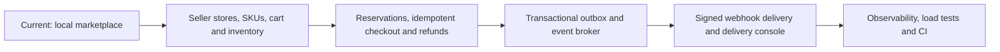

### M‑22: SKU checkout reservations

Store variant → **Start checkout** → choose quantity → sign in → reserve for 10 minutes. This is a stock-hold stage, not a payment or confirmed order. The older listing/Razorpay flow is separate and unchanged.

```mermaid
sequenceDiagram
  participant B as Buyer checkout
  participant A as Authenticated API
  participant D as PostgreSQL
  B->>A: SKU, quantity, idempotency key
  A->>D: reserve_inventory (single atomic call)
  D->>D: Lock request key, then SKU
  D->>D: Recheck active holds and physical stock
  D->>D: Allocate across warehouses; expiry = DB clock + 10 min
  D-->>A: Reservation ID (or insufficient stock)
  A-->>B: Owner-only hold summary + server time
  Note over D: Available = physical stock minus unexpired allocations
  Note over B,D: Expired holds stop counting without a release worker
```

- Idempotent retries return the same reservation, including after expiry; they never extend the deadline. A changed payload with the same key is rejected. One active checkout per buyer/SKU limits accidental duplicate holds.
- Creation is serialized per SKU in a volatile database function. Fresh statements after the lock avoid stale pre-lock snapshots. Concurrent buyers cannot allocate the same remaining stock.
- Physical quantities are unchanged. A database trigger prevents seller updates below active allocated stock, atomically preserving the M‑21 audit behavior.
- Availability is public and does not expose warehouse addresses or buyer records. Reservation details are owner-only. Admin/staff checkout, own-store checkout, hidden/inactive SKUs and non-approved sellers are rejected (admin-owned public test stores remain eligible).
- No payment capture, stock deduction, cancellation or order finalization is claimed. Expired records remain for history; availability ignores them using database time, not a client timer or cron.
- Local integration evidence: holds spanning warehouses, concurrent last-stock requests, concurrent duplicate retries, owner isolation, server-owned price, stock-update rollback, actual timed expiry and no double release.
- Live M‑22 verification (9 October 2026): a signed-in buyer reserved one M17-BLACK-128 unit. Availability decreased from 17 to 16 and the same reservation survived page reload. Its database deadline was exactly 10 minutes after creation (11:47:16–11:57:16 IST). After natural expiry, the live page displayed “Reservation expired” and availability returned to 17. A read-only database check confirmed the expired record retained one allocation and physical stock remained 17. No payment, shipment, manual expiry edit or release job was involved. M‑22 is completed; this does not claim paid SKU-order finalization or completion of later milestones.

```bash
# Local fixtures only; refuses a non-local DATABASE_URL
docker compose exec -T app sh -c 'RUN_RESERVATION_INTEGRATION=1 npx tsx --test tests/reservations.integration.test.ts'
# Fresh environments need both Drizzle tables and this function/trigger migration
node --env-file=.env.local scripts/migrate-inventory-reservations.mjs
```

### M‑23: Final-unit oversell prevention

M‑23 proves the exact checkout race in the roadmap: two different buyers try to reserve the final physical unit concurrently, and exactly one succeeds.

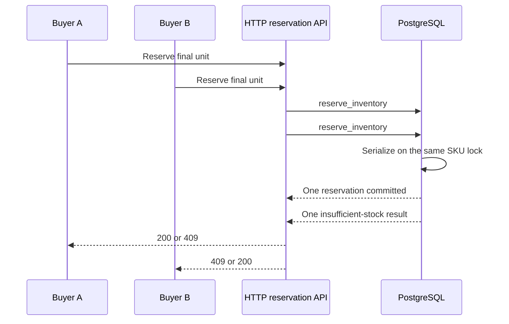

- The integration test sends two independent HTTP requests with different authenticated buyer identities and idempotency keys against a SKU with physical quantity `1`.
- A test-held row lock creates a deterministic race barrier. The test confirms both requests reached PostgreSQL and were waiting on the same SKU before releasing them.
- It then requires statuses `200` and `409`, exactly one reservation row, exactly one allocated unit, physical stock still equal to `1`, and public availability equal to `0`.
- Winner replay is idempotent; loser retry remains rejected and cannot create another reservation.
- Verified locally on 14 October 2026 for five consecutive contention rounds. This is evidence for reservation-stage oversell prevention, not paid-order finalization, Clerk browser UI, or production load capacity.

```bash
# Local fixtures only; refuses a non-local DATABASE_URL
docker compose exec -T app sh -c 'RUN_OVERSELL_INTEGRATION=1 npx tsx --test tests/oversell.integration.test.ts'
```

### M‑24: Release stock after payment failure or expiry

An active reservation now has three server-owned states: `held`, `released`, or `expired`. A buyer-owned payment-failure request atomically marks a live hold as released; availability ignores that hold immediately while retaining its allocation as an audit record. Natural expiry remains based on the PostgreSQL clock and needs no cleanup worker.

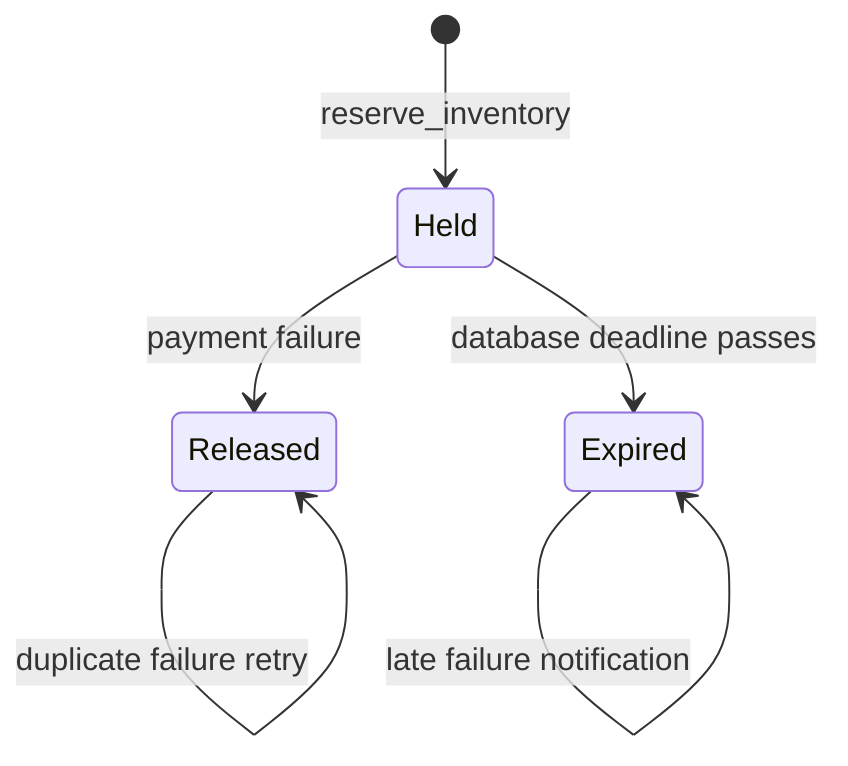

- Release authorization is owner-only. Another buyer receives `404` and cannot change the hold.
- The database locks the reservation before the failure transition. Duplicate failure delivery returns the original release timestamp instead of releasing twice.
- Allocations and physical stock remain unchanged for auditability. Sellable availability is calculated from unexpired, unreleased holds.
- Local HTTP/SQL evidence on 14 October 2026: reserving 4 of 5 units reduced availability to 1; payment failure restored availability to 5; retry preserved one release timestamp; a separate 5-unit hold expired back to 5 and a late failure notification did not double-release; physical stock remained 5.
- This milestone proves the reservation failure transition. It does not claim a paid SKU order, Razorpay webhook ingestion, refund processing, or the later cart/checkout state machine.

```bash
# Local fixtures only; refuses a non-local DATABASE_URL
docker compose exec -T app sh -c 'RUN_RELEASE_INTEGRATION=1 npx tsx --test tests/reservation-release.integration.test.ts'
# Apply after 0010_inventory_reservations.sql in a fresh deployed environment
node --env-file=.env.local scripts/migrate-reservation-release.mjs
```

### M‑25: Persistent buyer cart with current SKU pricing

Buyers can add an active SKU, keep one cart across requests, change its quantity from 1–20, and remove it. The cart belongs to the authenticated buyer—not to a browser tab—and another buyer cannot read or mutate it.

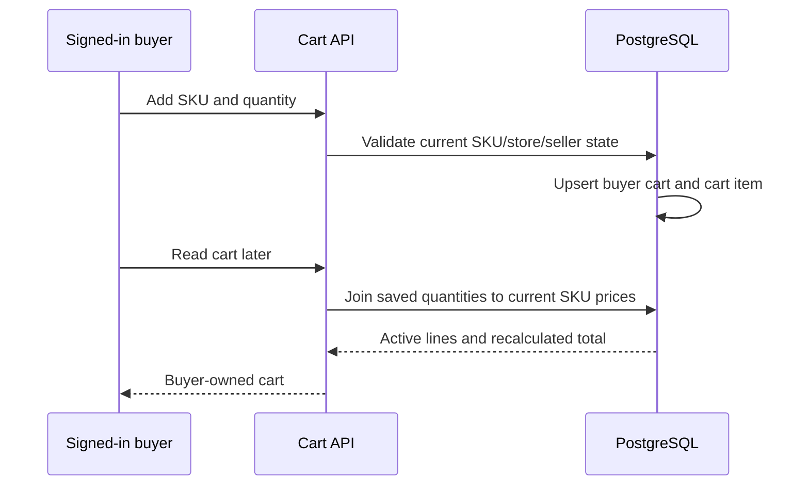

- `carts.buyer_id` is unique, so each buyer has one durable cart. `(cart_id, variant_id)` is the item key and the database constrains quantities to 1–20.
- The client never supplies a price. Every cart read joins the saved quantity to the current variant, product, public store and approved seller state. Active lines use the current SKU price; inactive/hidden lines remain visible but contribute zero to the total.
- Adding an inactive/hidden SKU or the seller's own SKU is rejected. Buyer identities are isolated, and non-buyer roles cannot use the API.
- Local HTTP/SQL evidence on 15 October 2026: buyer A added 2 units at ₹125 and received ₹250; a fresh request returned the same cart; buyer B received an empty cart; changing the SKU price to ₹150 recalculated buyer A's total to ₹300; quantity 3 recalculated to ₹450; deactivating the product excluded the line; cross-buyer removal, own-store addition and admin access were rejected.
- Scope: this milestone is the persistent cart only. It does not claim cart-to-reservation conversion, paid orders, tax/shipping calculation, coupons or checkout finalization.

```bash
# Local fixtures only; refuses a non-local DATABASE_URL
docker compose exec -T app sh -c 'RUN_CART_INTEGRATION=1 npx tsx --test tests/cart.integration.test.ts'
# Apply after the catalog tables exist in a deployed environment
node --env-file=.env.local scripts/migrate-buyer-cart.mjs
```

### M‑26: Atomic cart checkout

The cart page now reserves every active SKU and submits those buyer-owned holds to one PostgreSQL checkout transaction. That transaction locks the buyer cart and reservations, revalidates current products, sellers, quantities and prices, and either creates every checkout record or creates none.

```mermaid
sequenceDiagram
  participant B as Buyer cart
  participant A as Checkout API
  participant D as PostgreSQL transaction
  B->>A: Cart reservation IDs
  A->>D: create_cart_checkout
  D->>D: Lock cart + reservations
  D->>D: Revalidate buyer, active SKUs, quantities, prices, expiry
  alt every validation passes
    D->>D: Insert order + immutable order items
    D->>D: Insert payment intent
    D->>D: Insert pending order.created outbox event
    D->>D: Clear cart items
    D-->>A: Consistent checkout IDs and total
  else any validation fails
    D-->>A: Error; no checkout records created
  end
```

- Each order item records the exact SKU, reservation, seller, store, quantity, unit price and line total used at checkout. A reservation is unique across order items, preventing reuse.
- The server creates an `internal_test` payment intent in `requires_payment_method`; the browser cannot supply its ID, amount, currency, order ID or event payload.
- The transaction writes one pending `order.created` outbox record alongside the order and payment intent. Event publishing is a later milestone; this milestone proves atomic outbox creation only.
- Local HTTP/SQL evidence on 15 October 2026: an invalid cross-buyer reservation produced zero orders, payment intents and outbox events and left the cart intact. A valid two-SKU cart (2 × ₹125 plus 1 × ₹200) created exactly one ₹450 order, two matching immutable items, one ₹450 payment intent and one pending outbox event, then cleared only that buyer's cart. Reusing a consumed reservation was rejected and all record counts remained one.
- Scope: no payment was captured, no external provider intent was created, inventory was not deducted, and the outbox event was not published. Those remain separate later milestones.

```bash
# Local fixtures only; refuses a non-local DATABASE_URL
docker compose exec -T app sh -c 'RUN_CART_CHECKOUT_INTEGRATION=1 npx tsx --test tests/cart-checkout.integration.test.ts'
# Apply after reservation and cart migrations
node --env-file=.env.local scripts/migrate-cart-checkout.mjs
```

### M‑27: Idempotent checkout and payment-intent creation

Every cart checkout now requires a buyer-generated idempotency key. PostgreSQL serializes requests for the same buyer/key before reading or writing checkout state, so retries return the original order, payment intent and outbox event instead of creating duplicates.

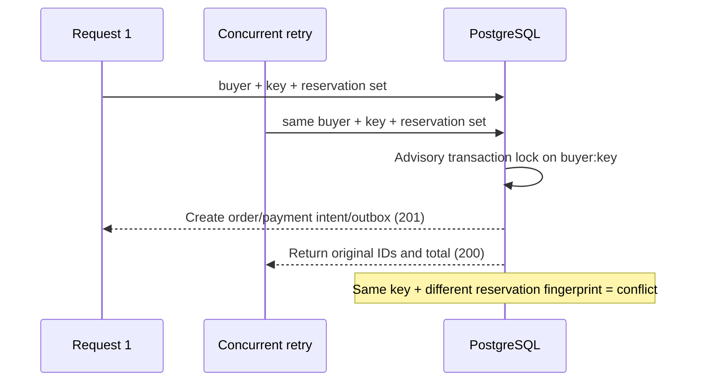

- Keys are scoped per buyer and protected by a unique database index. Different buyers may safely use the same key.
- A sorted reservation-set fingerprint binds the key to its original request. Reordering the same reservations is a retry; changing the set returns a conflict instead of returning an unrelated result.
- Payment-intent creation is inside the same idempotent database function, so a retry cannot produce a second payment intent even after the cart has been cleared by the original request.
- Local concurrent HTTP/SQL evidence on 16 October 2026: two simultaneous requests with the same buyer, key and two reservations returned one `201` and one replay `200`; both returned the same order, payment-intent and outbox IDs and ₹450 total. Database counts remained exactly one order, one payment intent and one outbox event. Reusing that key with a different reservation set returned `409` without new records.
- Scope: this proves application/database idempotency for VyapaarCart's internal checkout payment-intent record. No external payment-provider request or capture is claimed.

```bash
# Covered by the cart-checkout integration suite; local database only
docker compose exec -T app sh -c 'RUN_CART_CHECKOUT_INTEGRATION=1 npx tsx --test tests/cart-checkout.integration.test.ts'
node --env-file=.env.local scripts/migrate-checkout-idempotency.mjs
```

### M‑29: Authorized cancellation with reservation restoration

An unpaid buyer order can move from `pending_payment` to `cancelled` through one PostgreSQL transaction. The transaction locks the order and payment intent, releases every still-active reservation, cancels the internal payment intent, timestamps the order and writes one pending `order.cancelled` outbox event.

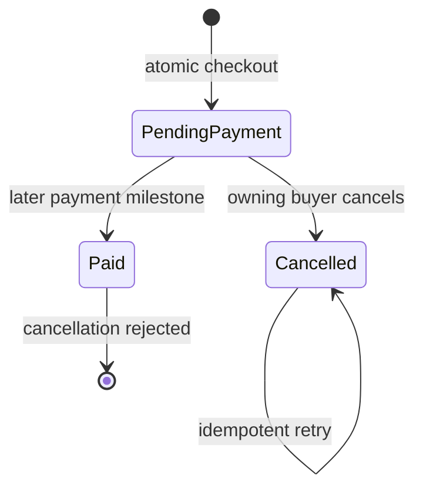

- Authorization is owner-only. A different buyer receives `404`, preventing both cancellation and order-ID disclosure.
- Only `pending_payment` with an internal payment intent still in `requires_payment_method` is cancellable. Any other order/payment state returns `409` without changing inventory.
- Cancellation retains reservation/allocation records for audit, marking active reservations `order_cancelled`. Availability immediately stops counting those holds; physical warehouse quantity is not incorrectly incremented.
- The transition, payment-intent change, reservation releases and outbox event are atomic. A retry returns the original timestamp/event/result and creates no duplicate event.
- Local real HTTP/PostgreSQL evidence on 16 October 2026: a stranger was rejected; a forced non-cancellable state was rejected; the owner cancelled an order holding 2 and 1 units; availability restored from 8→10 and 9→10; both reservation reasons, order/payment states and the single cancellation event were verified; retry changed no counts.
- Scope: this is pre-payment cancellation only. Paid-order cancellation, refunds, seller cancellation and external payment-provider actions remain later milestones.

```bash
# Covered by the cart-checkout integration suite; local database only
docker compose exec -T app sh -c 'RUN_CART_CHECKOUT_INTEGRATION=1 npx tsx --test tests/cart-checkout.integration.test.ts'
node --env-file=.env.local scripts/migrate-order-cancellation.mjs
```

### M‑30: Authorized refund workflow

Administrators can issue a full refund only after an order and its payment intent are both in paid/succeeded states. The API creates an idempotent refund request, invokes the configured payment provider through a provider-neutral interface, and then atomically persists the provider result, refunded order/payment states, immutable audit history and a pending `order.refunded` outbox event.

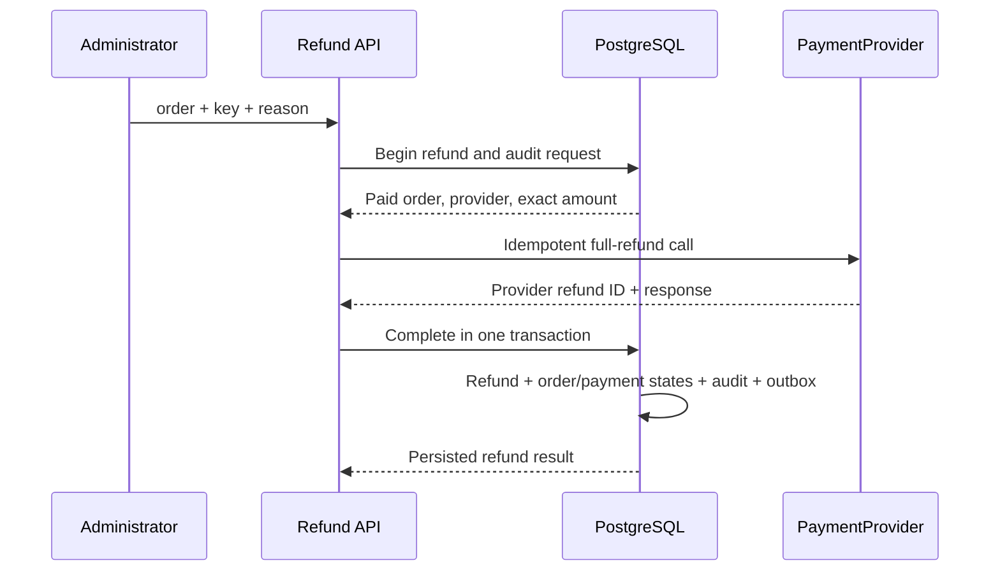

- Authorization is deliberately admin-only. Buyers, including the order owner, cannot issue refunds.
- The amount, currency, payment intent and provider come from persisted server records; the request may provide only a bounded reason and idempotency key.
- `PaymentProvider` separates refund orchestration from the current `internal_test` adapter. That adapter returns a deterministic provider refund ID for the same payment-intent/key pair, modelling a provider idempotency contract without claiming a real money movement.
- `refunds` stores the provider call result and raw response. `refund_audits` stores `refund.requested` and `refund.succeeded` transitions. Completion changes the order to `refunded`, the payment intent to `refunded`, and creates one `order.refunded` outbox event in one database transaction.
- A provider exception is persisted as `failed` plus a `refund.failed` audit record; order and payment states remain paid/succeeded. Retrying the same key reuses the refund record and provider idempotency key.
- Local real HTTP/PostgreSQL evidence on 16 October 2026: unpaid refund was rejected; buyer refund was rejected; an admin refunded exactly ₹125; the deterministic provider ID/response, both state changes, two audit events and one outbox event were persisted; same-key replay returned the original result and a new key created no duplicate.
- Scope: the current verified provider is an internal test adapter. No Razorpay/Stripe refund or real money movement is claimed; provider contract parity is tracked separately in M‑31.

```bash
# Covered by the cart-checkout integration suite; local database only
docker compose exec -T app sh -c 'RUN_CART_CHECKOUT_INTEGRATION=1 npx tsx --test tests/cart-checkout.integration.test.ts'
node --env-file=.env.local scripts/migrate-refund-workflow.mjs
```

### M‑31: Payment provider abstraction

Payment operations now depend on one `PaymentProvider` contract rather than a provider-specific route implementation. Both adapters implement checkout creation, payment verification, and refunds: `internal_test` provides deterministic local behavior for the SKU checkout/refund workflow, while `razorpay_test` maps the same contract to Razorpay's test-mode order, signature-verification, and refund APIs.

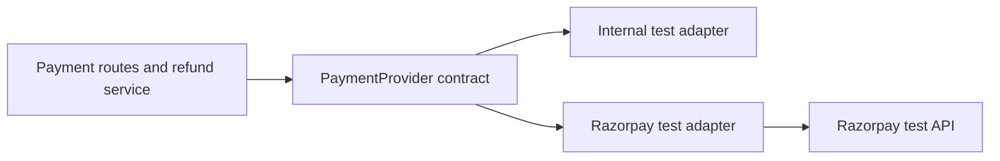

- The marketplace payment-create and signature-verification routes now call the Razorpay adapter; provider authorization, request shape, paise conversion, response validation, and error normalization are kept in one server-only module.
- The Razorpay adapter accepts only `rzp_test_` keys, sends ₹ values to Razorpay in paise, URL-encodes the provider payment ID for a refund, and uses the existing constant-time HMAC verification path. It does not expose the secret to the browser.
- Contract tests execute the same checkout → verification (valid and invalid) → refund sequence against both adapters. The Razorpay test uses an injected transport: it asserts the exact `/v1/orders` and `/v1/payments/{id}/refund` requests, `125` rupees → `12500` paise conversion, Basic authorization shape, and sanitized error behavior without making a network request or creating a refund.
- Scope: Razorpay integration is intentionally test mode. The live release does not invoke a real Razorpay checkout or refund during verification, and no live-money payment/refund claim is made.

### M‑33: Shipping and tracking abstraction

Shipment creation and tracking advancement now depend on a `ShippingProvider` contract. The live application uses `LocalSandboxShippingProvider`, preserving the existing test delivery lifecycle, while the order-domain service accepts any provider implementing the same create/advance operations.

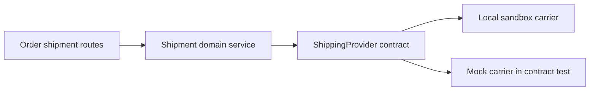

- Provider output owns carrier name, tracking number, status, ETA, event message and optional carrier identifiers. The route persists those neutral results and updates the order only when the returned tracking state is `delivered`.
- The M‑33 test injects a mock carrier, verifies a provider-produced label and metadata are persisted into the domain record, advances the same record to `picked_up`, and confirms the completed state produces no additional transition. No route or order-domain code changes for the mock.
- Scope: the default provider remains the local deterministic simulator. This is an abstraction milestone, not a Shiprocket/Delhivery integration or a real courier-booking claim.

### M‑36: Shiprocket carrier adapter

The shipping contract now has a concrete `ShiprocketShippingProvider`. It uses distinct Shiprocket sandbox and production API bases and is selectable only through server-side configuration; the local simulator remains the default when no provider is selected.

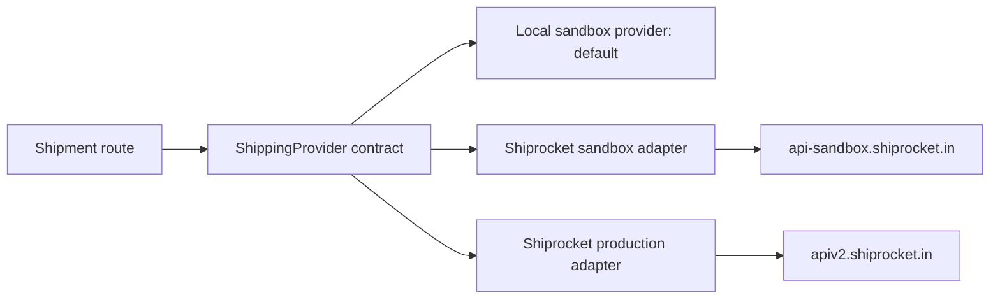

- The Shiprocket adapter authenticates with environment-specific server-side credentials, creates an ad-hoc order, assigns an AWB, and translates carrier tracking statuses into the marketplace's neutral shipment states.
- Select `shiprocket_sandbox` with `SHIPROCKET_SANDBOX_EMAIL` / `SHIPROCKET_SANDBOX_PASSWORD`, or `shiprocket_production` with the corresponding `SHIPROCKET_PRODUCTION_*` variables. Do not expose these values to the browser or commit them.
- Contract tests inject a fake transport and independently assert sandbox and production base URLs, credentials, auth, order, AWB, and tracking request shapes. They make no external network request and do not create a carrier booking.
- Scope: this verifies the production-provider integration contract, not a live carrier booking. Production credentials and a real booking remain opt-in operational actions.

### M‑39: Order notifications

Key marketplace order events produce notifications for the affected account: new order requests, acceptance/cancellation, verified test payments, shipment-label creation, and shipment tracking changes. Each recipient/event/channel combination has one database-enforced delivery key.

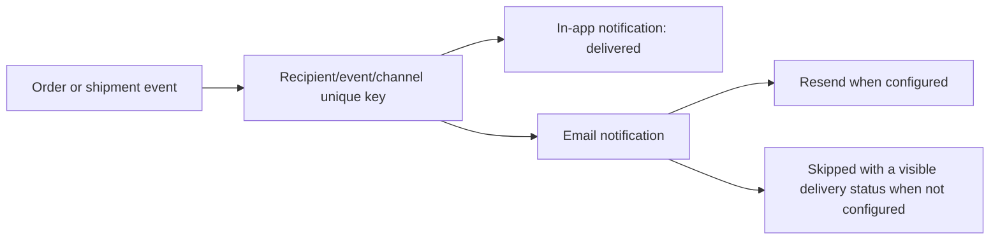

- `GET /api/notifications` returns only in-app records owned by the signed-in user. A user cannot read or mark another user's notification as read.
- The email adapter posts to Resend with a provider idempotency key. When no verified Resend sender is configured, the email record is explicitly marked `skipped`; it is not falsely reported as delivered.
- Tests prove that a duplicate order event creates one in-app delivery and sends one email, uses a provider idempotency key, and does not expose an API key in failure text.

### M‑42: Traceable platform commissions

Every checkout item stores the platform commission rate that applied when the order was created. Commission reporting therefore reads immutable item snapshots instead of today's mutable configuration, and a refund contributes an equal negative reversal tied to the same order and item records.

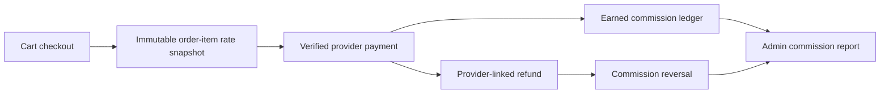

- `order_items.commission_rate_bps` is set during checkout and protected by a database trigger from later modification. Historical settled rows without a defensible rate remain `NULL` and make reporting fail closed rather than fabricate revenue.
- Payment verification checks the provider payment's status, amount, and currency before one database transaction commits reservations, marks the order paid, records the provider identifiers, and creates the `order.paid` outbox event.
- Refunds reference the real provider payment ID. A completed refund produces a negative commission entry, so gross commission, reversals, and net commission reconcile to order-item values.
- The admin report uses the stored rate on each item and returns a conflict for an inconsistent settled order instead of silently omitting it.
- Verified against a disposable Neon branch and local PostgreSQL through checkout → payment capture → stock commit → commission report → provider-linked refund → commission reversal. The same production migration was then applied and schema-verified on the production Neon branch.

## Resume-safe project description

Use this now:

> Built and deployed VyapaarCart, a full-stack local marketplace using Next.js, TypeScript, Neon Postgres, Drizzle, Clerk, S3-compatible storage, and Razorpay test mode. Implemented authenticated seller stores, SKU inventory and expiring reservations, idempotent multi-item checkout, verified test payments and refunds, immutable per-item commission snapshots with refund reversals, buyer–seller messaging, and persisted simulated shipment tracking.

Do **not** claim live-money settlement, Kafka, Redis, FastAPI, real courier booking, webhooks, or measured scale. The checkout, payment, refund, and commission lifecycle is verified in provider test mode. Add new claims only after they are genuinely implemented and tested.

## Licence

Built as a personal portfolio project.
